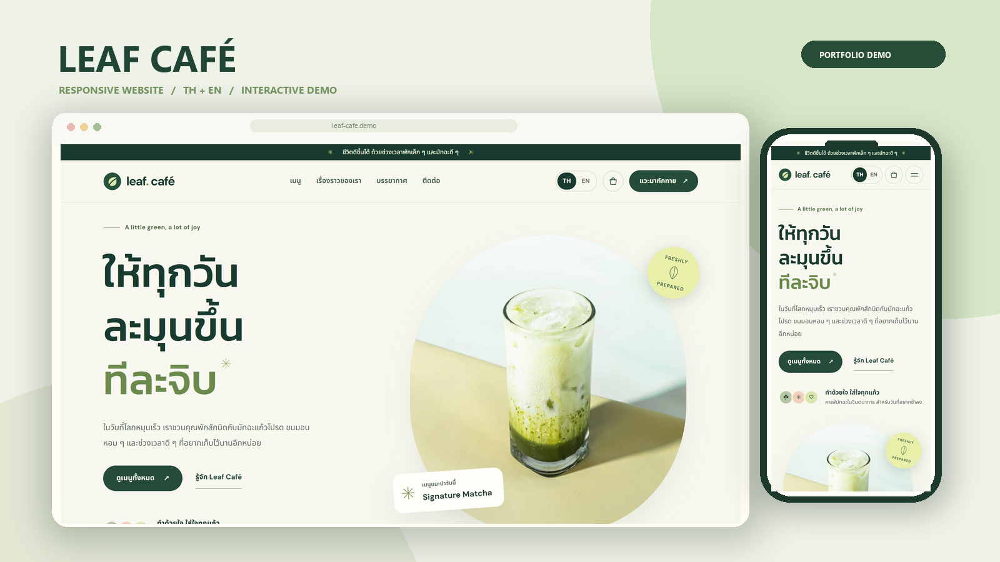

# Leaf Café — Web Development Portfolio Demo

A bilingual (Thai/English), responsive landing page for a **fictional** matcha café, built as a Fastwork web development portfolio sample.

> **Demo project / concept website.** Leaf Café is not a real business and this is not client work. Menu items, prices and copy are made up. The bag and contact form are demonstrations only: no orders, payments or messages are sent anywhere.



## คำอธิบายผลงาน (สำหรับ Fastwork)

**Leaf Café — เว็บไซต์โปรโมตร้านคาเฟ่ (ผลงานตัวอย่าง / ร้านสมมติ)**

เว็บไซต์หน้าเดียวสำหรับร้านมัทฉะและคาเฟ่ รองรับภาษาไทยและอังกฤษในปุ่มเดียว แสดงผลสวยทั้งมือถือ แท็บเล็ต และคอมพิวเตอร์ มีเมนูที่กรองตามหมวดหมู่ได้ ตะกร้าตัวอย่างที่เพิ่ม ลด และคำนวณราคารวมได้ทันที และฟอร์มติดต่อที่ตรวจข้อมูลก่อนส่งพร้อมบอกจุดที่ต้องแก้ไขชัดเจน เขียนด้วย HTML, CSS และ JavaScript ล้วน ไม่ใช้ framework จึงโหลดเร็ว แก้ไขเนื้อหาง่าย และนำขึ้นโฮสติ้งแบบ static ได้ทุกเจ้า

> หมายเหตุ: เป็นผลงานตัวอย่างเพื่อแสดงฝีมือ ไม่ใช่ร้านค้าจริงและไม่ใช่งานของลูกค้า ตะกร้าและฟอร์มเป็นระบบสาธิต ไม่มีการสั่งซื้อ ชำระเงิน หรือส่งข้อมูลจริง

## Features

- **Responsive layout** checked at 320, 375, 768, 1024, 1440 and 1920 px with no horizontal scrolling.
- **Thai/English switch** (TH | EN). Every visible string, image description and accessible label is translated. Only the language choice is saved in `localStorage`.
- **Filterable menu** of six fictional products (all / drinks / desserts), with a screen-reader announcement of the result count.
- **Demo bag**: add items, change quantities with − / +, remove items and see the running total. Keyboard friendly: focus moves into the drawer, stays inside it, and returns when it closes (Esc, backdrop or close button).
- **Contact form validation** per field (required, minimum length, email format, maximum length), with inline messages, `aria-invalid`, focus moved to the first problem, and messages that re-translate when the language changes.
- **Accessibility basics**: skip link, landmarks, one `h1` and no skipped heading levels, visible focus outlines, WCAG AA text contrast, every control at least 24×24 px (WCAG 2.5.8; the main touch controls are 40–44 px), labelled form fields, `prefers-reduced-motion` support, `lang` set per language.
- **Security headers in the page**: a Content-Security-Policy meta tag (`script-src 'self'`, `connect-src 'none'`, `form-action 'none'`) so the page cannot send form data even if JavaScript fails.
- **Menu photography**: six real food photos from Pexels (free licence, credited in [`assets/photos/CREDITS.md`](assets/photos/CREDITS.md)). They share a 1.19:1 crop, are about 20–165 KB each as WebP, and are lazy-loaded. The hero "Signature Matcha" uses the same matcha photo, cropped to the hero arch (`hero-matcha.webp`). The story illustration is original SVG artwork made for this demo; the original hero SVG is kept as a fallback.
- **Stable scrolling**: closing the bag with ×, Esc or the backdrop keeps the page exactly where it was. "Continue" goes to the menu on purpose.

### Demo limitations

- The **bag** has no checkout, payment, stock or persistence. It resets on reload.
- The **contact form** validates input and shows a success message, but **never sends or stores anything**. Connecting it to email or a database needs a backend, spam protection and a privacy notice, and would be separate scope.
- Prices and products are fictional. The menu photos are **stock images for illustration**, not pictures of real products; the page says so under the menu.

## Technologies

| Area       | Choice                                                                                                                           |
| ---------- | -------------------------------------------------------------------------------------------------------------------------------- |
| Markup     | Semantic HTML5                                                                                                                   |
| Styles     | Plain CSS with custom-property design tokens (`src/styles.css`)                                                                  |
| Scripts    | Vanilla JavaScript, classic scripts (no framework, no bundler)                                                                   |
| Fonts      | DM Sans, Kanit, Noto Sans Thai via Google Fonts (SIL Open Font License 1.1)                                                      |
| Quality    | Prettier, ESLint, Node's built-in test runner (`node --test`)                                                                    |
| Browser QA | Playwright (MCP during development; optional Python smoke test)                                                                  |
| Images     | Pexels photos (WebP) for the menu and hero, original SVG illustration for the story section; Pillow for photo prep and the cover |

The website itself has **no runtime dependencies**. Everything in `package.json` is a development tool.

## Project structure

```
index.html                  Page markup (lang="th" by default)
src/
  styles.css                All styles; design tokens in :root
  content.js                Thai/English copy and the demo menu (edit content here)
  logic.js                  Pure helpers: translation, prices, bag maths, form validation
  main.js                   DOM wiring: language, menu, bag drawer, form, navigation
assets/                     SVG illustrations, favicon, og-image.png (social preview)
  photos/                   Menu photos (WebP) + CREDITS.md (sources and licence)
  menu-*.svg                Original menu illustrations, kept as a fallback
tests/
  logic.test.js             Unit tests for src/logic.js
  site.test.js              Static checks: TH/EN key parity, markup, demo-only behavior
  load-scripts.js           Loads the browser scripts into node:vm for tests
  smoke.spec.py             Optional Python Playwright smoke test (standalone file)
  capture_gallery.py        Optional Python Playwright section screenshots
tools/
  build.mjs                 npm run build -> dist/ (copies only the website files)
  build_standalone.py       Builds leaf-cafe-standalone.html (single offline file)
  make_cover.py             Builds the 1600x900 Fastwork cover from screenshots
  prepare_photos.py         Crops/converts downloaded Pexels originals into assets/photos/
  og-card.html              Source layout for assets/og-image.png
  generate_assets.py        Regenerates the SVG illustrations (overwrites assets/)
  requirements.txt          Python tool dependencies (Pillow)
screenshots/                Portfolio images (desktop, tablet, mobile, sections)
leaf-cafe-standalone.html   Generated single-file copy for offline previews
```

## Run locally

Requirements: Node 22+ and Python 3 (for the simple local server).

```powershell
npm install        # dev tools only
npm run serve      # http://localhost:5500
```

You can also open `index.html` directly, or double-click `leaf-cafe-standalone.html` (fully offline, system fonts).

## Checks and tests

```powershell
npm run check      # Prettier check + ESLint + unit/static tests
npm run format     # fix formatting
npm run build      # create dist/ for hosting
npm run preview    # serve dist/ at http://localhost:5501
```

Optional Python tools use a project-local virtual environment:

```powershell
python -m venv .venv
.venv\Scripts\pip install -r tools/requirements.txt   # Pillow, for make_cover.py
.venv\Scripts\python tools\build_standalone.py        # rebuild the offline single file
.venv\Scripts\python tools\make_cover.py              # rebuild the Fastwork cover
```

`tests/smoke.spec.py` and `tests/capture_gallery.py` also need `pip install playwright` in the same venv. They use the installed Chrome or Edge, so no browser download is needed. Their debug screenshots go to `output/smoke/`, which is gitignored.

## Deployment (static hosting)

The site is static files only. `npm run build` creates `dist/`, which contains only `index.html`, `_headers`, `src/` and `assets/`. Tests, tools and screenshots are left out.

### Current deployment: Netlify, manual upload (Netlify Drop)

Live site: <https://chic-moonbeam-379b0e.netlify.app/>. It is not connected to Git; every update is a manual upload of `dist/`.

To update the live site and keep the same URL:

1. `npm run check`, then `npm run build`.
2. Check that `dist/` contains `index.html`, `_headers`, `src/` and `assets/` at its top level.
3. Sign in at <https://app.netlify.com>, open the existing site **chic-moonbeam-379b0e** and go to its **Deploys** tab.
4. Drag the **`dist` folder** onto the drop area on the Deploys page ("drag and drop your site output folder here"). Netlify publishes it as a new deploy of the same site.
   - Do **not** use the stand-alone Netlify Drop page (app.netlify.com/drop) or "Add new site". Those create a new site with a different URL.
5. When the deploy shows **Published**, re-check the live site: open it, and run `curl -I https://chic-moonbeam-379b0e.netlify.app/` to confirm the headers.

Rollback: in **Deploys**, open an earlier deploy and choose **Publish deploy**.

`_headers` gives Netlify the security headers: `X-Content-Type-Options`, `X-Frame-Options`, `Referrer-Policy`, `Permissions-Policy`, and a Content-Security-Policy that adds `frame-ancestors 'none'` to the CSP in `index.html`. If the site ever needs to be shown inside an iframe (for example an embedded portfolio viewer), relax `X-Frame-Options` and `frame-ancestors` deliberately.

### Social preview URLs

`index.html` uses absolute URLs for `canonical`, `og:url`, `og:image` and `twitter:image`, because social crawlers ignore relative image paths. If the site moves to a custom domain, update those four lines and redeploy. To refresh a cached preview, use the Facebook Sharing Debugger, or share the link again in LINE.

### Other static hosts

Any static host can serve `dist/`. Vercel and Cloudflare Pages: build command `npm run build`, output directory `dist`. GitHub Pages: publish the contents of `dist/`. These hosts ignore `_headers` unless they support it (Cloudflare Pages does), so set equivalent headers in the host's own configuration.

## Customizing for a real client

- Edit text and menu items in `src/content.js` (both languages must keep the same keys; `npm test` checks this).
- Replace the stock menu photos with the client's own product photos (same 1000×840 WebP size; `tools/prepare_photos.py` shows the crop settings) and update `CREDITS.md`.
- A real contact form needs a backend or form service. Update the CSP `connect-src` / `form-action` accordingly and add a privacy notice.

## Licenses

- Website code and SVG illustrations: created for this demo.
- Menu photos: Pexels License (free commercial use, attribution not required; credited anyway). Photographers and source links: [`assets/photos/CREDITS.md`](assets/photos/CREDITS.md). Do not reuse them as a logo or trademark, or sell them unaltered.
- Fonts: DM Sans, Kanit and Noto Sans Thai, SIL Open Font License 1.1, loaded from Google Fonts. Remove the font `<link>` tags if a client prohibits third-party requests; the page falls back to system fonts.
- Dev tools: Prettier (MIT), ESLint (MIT), globals (MIT). Python tool: Pillow (MIT-CMU).
