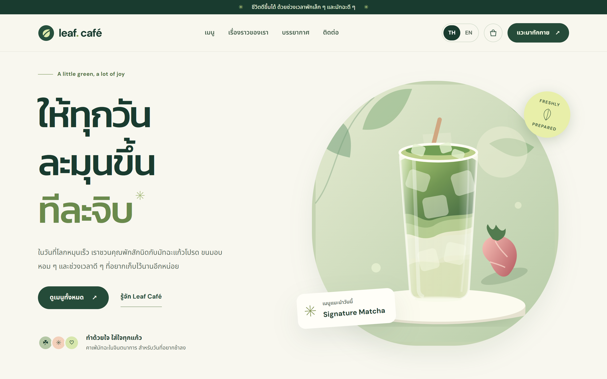
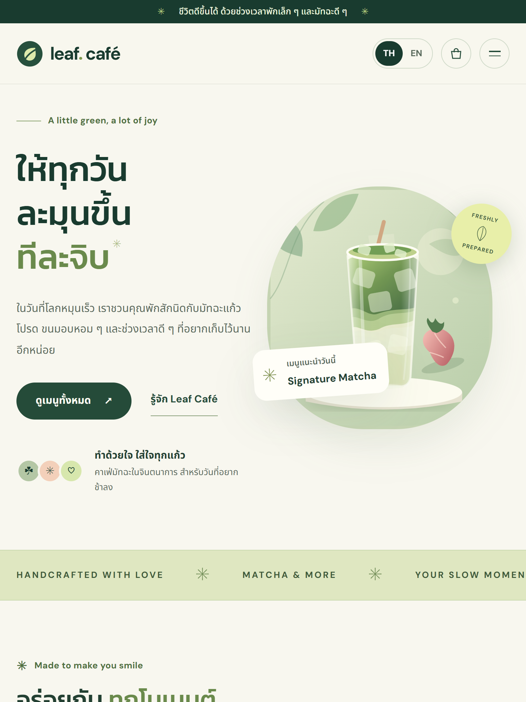
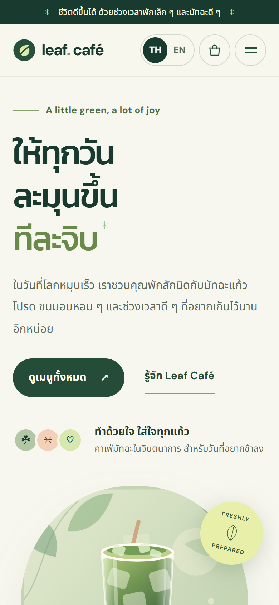
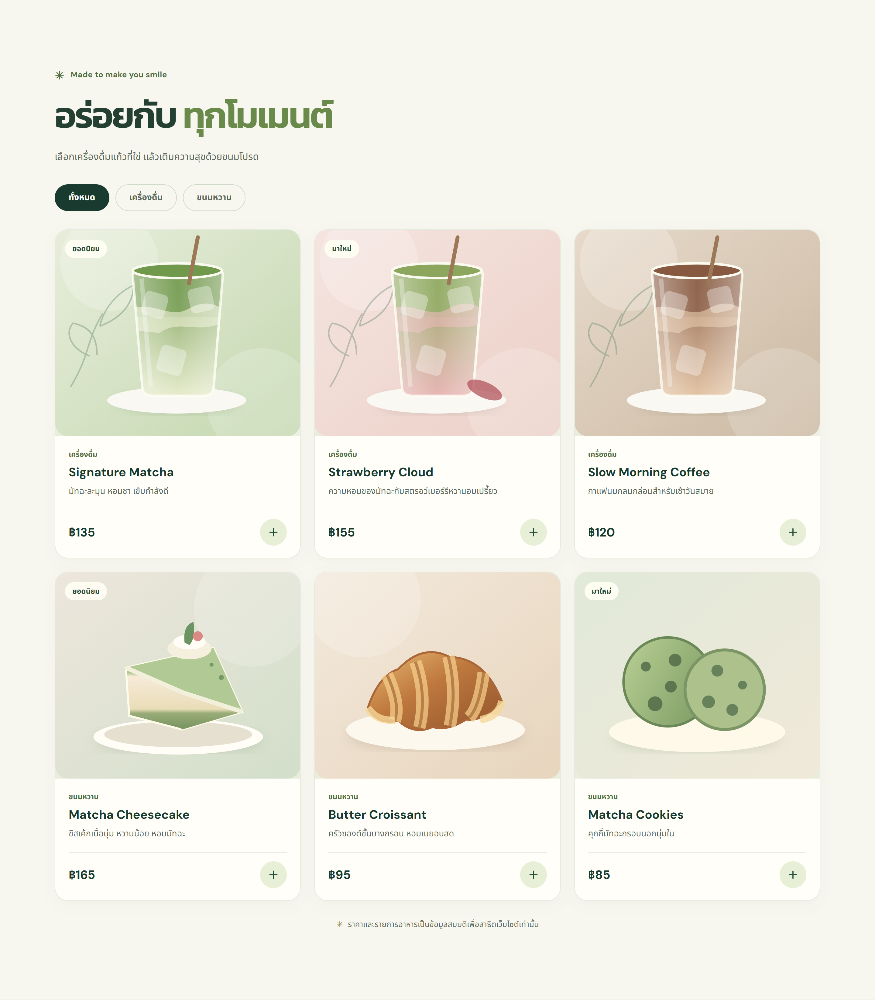
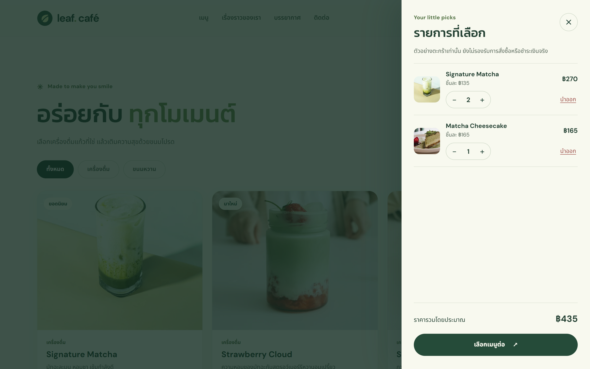
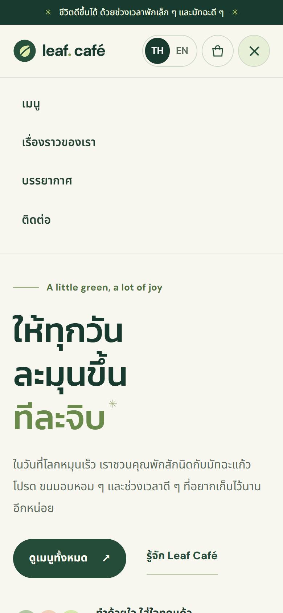
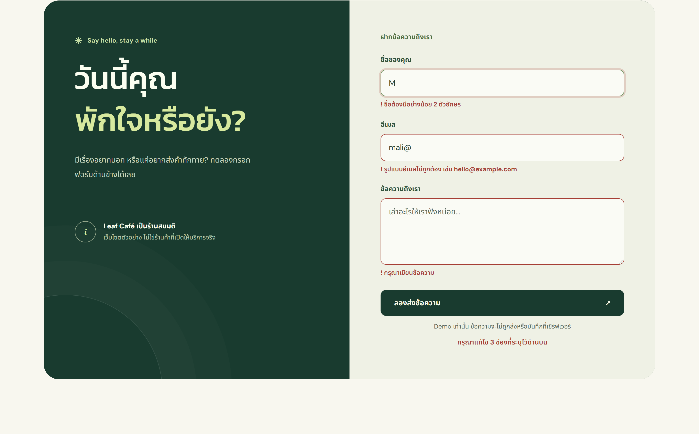
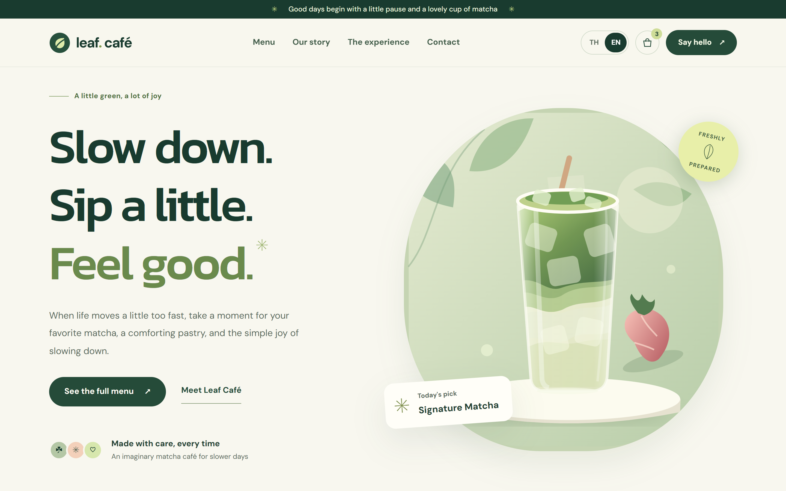
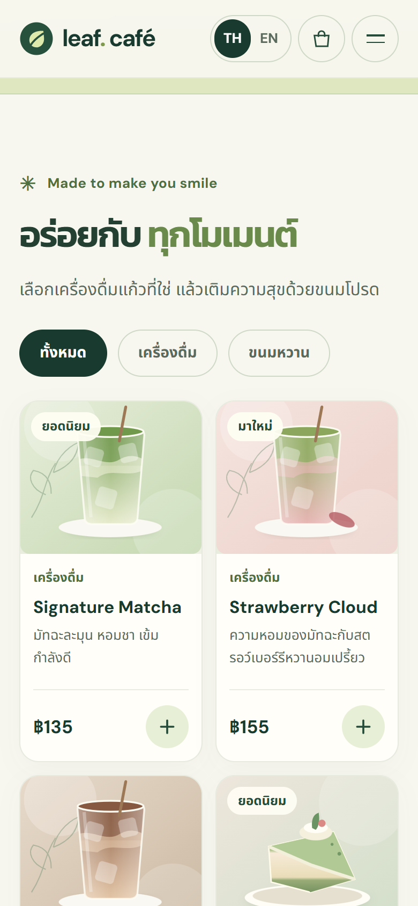

# Leaf Café

A bilingual (Thai/English), responsive landing page for a **fictional** matcha café. It is a portfolio demonstration for a freelance web development service on Fastwork.

**Live demo:** <https://chic-moonbeam-379b0e.netlify.app/>

> **Fictional demonstration project.** Leaf Café is not a real business and this is not client work. Menu items, prices and copy are invented. The shopping bag and contact form are demos only: there is no payment processing, no real order submission, and no message is sent or stored anywhere.


## Screenshots

| Desktop                                            | Tablet                                           | Mobile                                           |
| -------------------------------------------------- | ------------------------------------------------ | ------------------------------------------------ |
|  |  |  |

| Menu with filters                               | Shopping bag (demo)                                  | Mobile navigation                                    |
| ----------------------------------------------- | ---------------------------------------------------- | ---------------------------------------------------- |
|  |  |  |

| Form validation                                                   | English version                                    | Mobile menu cards                                           |
| ----------------------------------------------------------------- | -------------------------------------------------- | ----------------------------------------------------------- |
|  |  |  |

## ภาษาไทย (สรุปสั้น)

Leaf Café เป็นเว็บไซต์ตัวอย่างร้านคาเฟ่มัทฉะ (ร้านสมมติ) ทำขึ้นเพื่อแสดงผลงานรับทำเว็บไซต์ รองรับภาษาไทยและอังกฤษ แสดงผลได้ทั้งมือถือ แท็บเล็ต และคอมพิวเตอร์ มีเมนูที่กรองได้ ตะกร้าตัวอย่างที่คำนวณราคา และฟอร์มติดต่อที่ตรวจข้อมูลก่อนส่ง ตะกร้าและฟอร์มเป็นระบบสาธิต ไม่มีการสั่งซื้อ ชำระเงิน หรือส่งข้อมูลจริง

## Overview

A single-page site built with plain HTML, CSS and JavaScript, with no framework and no runtime dependencies. The aim is a site a small business owner could actually use and a developer could easily take over. Content lives in one file, logic is unit-tested, and `npm run build` produces a static `dist/` folder for any host.

## Features

- **Responsive layouts** for desktop, tablet and mobile. Checked at 320, 375, 768, 1024, 1440 and 1920 px with no horizontal scrolling.
- **Thai and English switching** (TH | EN). Every visible string, image description and accessible label is translated, and the choice is remembered (`localStorage`).
- **Interactive menu filtering**: all / drinks / desserts, with the result count announced to screen readers.
- **Shopping bag (demo)**:
  - Add items, change quantities with − / +, and remove items.
  - The line totals and estimated total update immediately.
  - Closing the bag keeps the page exactly where it was.
  - There is no checkout or payment.
- **Contact form validation**:
  - Each field is checked for required, minimum length, email format and maximum length.
  - Errors appear inline, with `aria-invalid`, and focus moves to the first problem.
  - Messages re-translate when the language changes.
  - Nothing is submitted.
- **Accessibility considerations**:
  - Skip link, landmarks, and a correct heading order.
  - Visible focus outlines and WCAG AA text contrast.
  - Every control is at least 24×24 px, and the main touch controls are 40–44 px.
  - Focus moves into the bag drawer, stays there while it is open, and returns to the trigger when it closes.
  - `prefers-reduced-motion` support, and `lang` set for each language.
- **Security**:
  - A Content-Security-Policy that blocks network requests from the page (`connect-src 'none'`) and blocks form submission (`form-action 'none'`).
  - Netlify security headers via [`_headers`](_headers): `X-Content-Type-Options`, `X-Frame-Options`, `Referrer-Policy`, `Permissions-Policy`, and `frame-ancestors`.
- **Real food photography**: free Pexels stock photos, credited in [`assets/photos/CREDITS.md`](assets/photos/CREDITS.md), served as optimized WebP.
- **Static deployment on Netlify**: plain files, with no server or database.

## Technology stack

| Area         | Choice                                                                        |
| ------------ | ----------------------------------------------------------------------------- |
| Markup       | Semantic HTML5                                                                |
| Styles       | Plain CSS with custom-property design tokens                                  |
| Scripts      | Vanilla JavaScript (classic scripts, no framework or bundler)                 |
| Fonts        | DM Sans, Kanit, Noto Sans Thai (Google Fonts, SIL Open Font License 1.1)      |
| Code quality | Prettier, ESLint                                                              |
| Tests        | Node's built-in test runner (`node --test`); Playwright for browser testing   |
| Images       | WebP photos (Pexels), SVG illustrations, Pillow scripts for image preparation |
| Hosting      | Netlify (static, manual deploys)                                              |

Everything in `package.json` is a development tool. The website itself has no runtime dependencies.

## Testing

- **Automated (run by `npm run check`):** 25 Node tests.
  - Unit tests for the bag maths, prices, translation and form validation (`tests/logic.test.js`).
  - Static checks (`tests/site.test.js`): TH/EN dictionaries have identical keys, translated markup is safe, there are no network calls, photos are credited, social preview URLs are absolute, and the security headers are present.
- **Browser testing with Playwright** (run during development; the results are in [`TEST_RESULTS.md`](TEST_RESULTS.md)):
  - Functional suites at 375, 768 and 1440 px against the source, the built `dist/` folder, the standalone file and the live Netlify site.
  - Responsive checks from 320 to 1920 px.
  - A bag-close scroll regression test: 4 close methods × 3 widths × 5 repetitions.
  - Console, network and CSP violation checks.
- **Optional Python smoke test:** [`tests/smoke.spec.py`](tests/smoke.spec.py) uses Python Playwright. It needs a project venv with `pip install playwright` plus Chrome or Edge, and is not part of `npm run check`.

## Run locally

Requirements: Node 22+ and Python 3 (only for the simple local server).

```bash
npm install        # development tools only
npm run serve      # http://localhost:5500
```

You can also open `index.html` directly, or double-click `leaf-cafe-standalone.html`. That single offline file has everything inlined and uses system fonts.

## Build and check

```bash
npm run check      # Prettier check + ESLint + tests
npm run format     # fix formatting
npm run build      # create dist/ for hosting (index.html, _headers, src/, assets/)
npm run preview    # serve dist/ at http://localhost:5501
```

Optional Python tools use a project-local virtual environment:

```bash
python -m venv .venv
.venv/Scripts/pip install -r tools/requirements.txt   # Pillow
.venv/Scripts/python tools/build_standalone.py        # rebuild the offline single file
.venv/Scripts/python tools/make_cover.py              # rebuild the cover image from screenshots
```

## Project structure

```
index.html                  Page markup (lang="th" by default)
_headers                    Netlify security headers (copied into dist/)
src/
  styles.css                All styles; design tokens in :root
  content.js                Thai/English copy and the demo menu (edit content here)
  logic.js                  Pure helpers: translation, prices, bag maths, form validation
  main.js                   DOM wiring: language, menu, bag drawer, form, navigation
assets/
  photos/                   Menu and hero photos (WebP) + CREDITS.md
  *.svg                     Story illustration, favicon, original illustrations kept as fallback
  og-image.png              1200×630 social preview image
tests/                      Node tests, test loader, optional Python Playwright scripts
tools/                      Build script, standalone builder, image preparation scripts
screenshots/                Portfolio images (desktop, tablet, mobile, sections)
leaf-cafe-standalone.html   Generated single-file copy for offline previews
TEST_RESULTS.md             What was actually tested, and what was not
```

## Deployment

The live demo is hosted on Netlify with **manual deploys**. It is not connected to this repository, and there is no automatic deployment. To update it, run `npm run check` and `npm run build`. Then open the existing site in Netlify, go to **Deploys**, and drag the `dist` folder onto the drop area. Do not use the stand-alone Netlify Drop page, which would create a new site with a different URL.

`index.html` uses absolute URLs for `canonical`, `og:url`, `og:image` and `twitter:image`. If the site moves to another domain, update those four lines.

Any other static host can serve `dist/` (build command `npm run build`, output directory `dist`). Hosts that do not read `_headers` need the same headers set in their own configuration.

## Image attribution and licensing

- **Photos:** free stock photos from [Pexels](https://www.pexels.com) under the [Pexels License](https://www.pexels.com/license/). It allows commercial use, does not require attribution, and allows modification. Each photographer and source link is listed in [`assets/photos/CREDITS.md`](assets/photos/CREDITS.md). The photos illustrate a fictional menu and are **not** pictures of real products.
- **Illustrations:** the SVG artwork was created for this demo.
- **Fonts:** DM Sans, Kanit and Noto Sans Thai (SIL Open Font License 1.1), loaded from Google Fonts.
- **Development tools:** Prettier, ESLint and globals (MIT), and Pillow (MIT-CMU).
- **This repository:** no open-source license has been chosen yet, so all rights are reserved by default. Please ask before reusing the code.

## Known limitations

- The shopping bag has no checkout, payment, stock or persistence, and it resets on reload.
- The contact form validates input but never sends or stores anything. A real form would need a backend or form service, spam protection, a privacy notice, and CSP changes.
- Prices and products are fictional, and the photos are stock images.
- Fonts load from Google Fonts. The page falls back to system fonts offline, and the standalone file always uses system fonts.
- Browser testing covered Chromium only (desktop and emulated mobile). Safari, Firefox and physical devices were not tested.
- The decorative ticker band is static and runs off the right edge on small screens by design.
